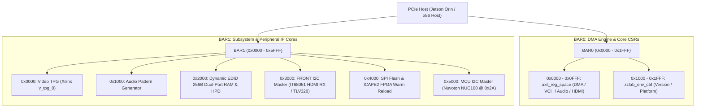
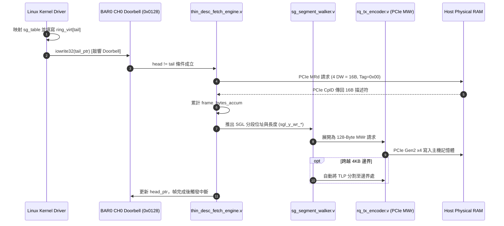

# M2-710 (Artix-7 A50T) PCIe Register Map 與 DMA 描述符規格書

- **文件版本**：1.0
- **日期**：2026-10-16
- **硬體標的**：QPCIe M2-710 視訊擷取卡（原專案或對話中曾誤記為 M2-720，現正式更正為 **M2-710**）
- **核心 FPGA**：AMD/Xilinx Artix-7 A50T (`xc7a50t-csg325-2`)
- **PCI 識別識別碼**：Vendor ID `0x12AB`, Device ID `0xE380`
- **PCIe 介面規格**：PCIe Gen2 x4 (5.0 GT/s), 128-bit AXI4-Stream
- **現行韌體版本**：`C_VERSION = 32'h26101603`
- **對應程式碼 Commit**：`ce5e88f` (`wip(hdmi): checkpoint native 4K60 RGB24 bring-up`)

---

## 1. 系統架構與 PCIe BAR 分配總覽

M2-710 PCIe 視訊擷取卡在主機端列舉為兩個主要 32/64-bit BAR 空間：
- **BAR0 (4KB / 8KB)**：DMA 傳輸核心、視訊／音訊通道、HDMI 接收遙測與系統環境暫存器。
- **BAR1 (64KB)**：板載週邊與 IP 控制區（包含視訊 TPG、動態 EDID、Front/MCU 雙 I2C、SPI Flash 及 ICAPE2 重載）。



---

## 2. BAR0 詳細暫存器定義 (DMA / 視訊 / 音訊 / HDMI 遙測)

BAR0 透過內部 AXI-Lite Crossbar 分為：
1. **`0x0000 - 0x0FFF`**：`axil_reg_space.v`（DMA 引擎、通道描述符基底、HDMI 遙測）。
2. **`0x1000 - 0x1FFF`**：`zzlab_env_ctrl.v`（硬體版本、平台字串、板卡版次）。

---

### 2.1 全域控制、版本與 DMA CSR (0x0000 - 0x00FF)

| Offset | 暫存器名稱 | 存取 | 預設值 / 欄位說明 |
|---|---|---|---|
| `0x00` | `REG_MAGIC_ID` / `DMA_CTRL` | RO / RW | **讀取**：返回 Magic ID `0x51504349` ("QPCI")<br>**寫入**：Bit 0: RUN, Bit 1: RESET, Bit 2: AUDIO_RUN |
| `0x04` | `REG_VERSION` / `DMA_STATUS` | RO | **讀取**：返回當前 `C_VERSION` (例如 `0x26101603`) |
| `0x08` | `REG_HARDWARE_CAPS` | RO | 硬體能力指標（Bit 0: SGL DMA, Bit 1: NV12M, Bit 2: RGB24, Bit 4: Audio） |
| `0x0C` | `REG_GIT_COMMIT_HASH` | RO | 建置時 Git Commit Hash 前 32-bit (例如 `0x0CE5E88F`) |
| `0x10` | `REG_BUILD_TIMESTAMP` | RO | UNIX Timestamp 建置時間 |
| `0x14` | `REG_GLOBAL_RESET` | WO | Bit 0: 寫入 1 觸發 Global Reset Pulse，刷新 DMA 與 FIFO |
| `0x18` | `REG_IRQ_TOP_STATUS` | R/W1C | 頂層中斷狀態：Bit 4: Audio DEV0, Bit 5: Error Event |
| `0x1C` | `REG_GLOBAL_TIMESTAMP_L` | RO | 64-bit 硬體奈秒計時器 [31:0] |
| `0x20` | `REG_GLOBAL_TIMESTAMP_H` | RO / WO | **讀取**：64-bit 硬體計時器 [63:32]<br>**寫入**：`REG_IRQ_CTRL` (中斷致能遮罩) |
| `0x24` | `REG_IRQ_STATUS` | R/W1C | 通道中斷狀態（Bit 0: H2C Global, Bit 1: C2H Global, Bit 4: VCH0 Done, Bit 11: Audio Ch0 Done） |
| `0x28` | `REG_DMA_STATUS` | RO | DMA 狀態：Bit 8: Video TX Idle, Bit 9: Desc Fetch FSM Idle |
| `0x2C` | `REG_REQUESTER_ID` | RO | [15:0]: PCIe Captive Requester ID (Bus / Device / Function) |
| `0x30` | `REG_COMPLETED_H2C` | RO | H2C 完成傳輸累計筆數 |
| `0x74` | `REG_PACER_CTRL` | RW | Video Pacer 控制（0: Bypass 硬體節奏器, 1: 啟用硬體節奏） |
| `0x78` | `REG_SLICE_HEIGHT` | RW | Sub-frame 切片中斷列數（0: 關閉切片/整幀中斷, >0: 每 N 列觸發切片中斷） |
| `0x7C` | `REG_VIDEO_ERRORS` | RO | **Ch0 Protocol Error 累計計數器**（驅動對應 `V4L2_CID_QPCIE_FRAME_DROP_COUNT`） |
| `0x80` | `REG_VIDEO_CTRL` | RW | Bit 0: 重設 TPG 與視訊 CDC FIFO |
| `0x84` | `REG_VIDEO_SUB_RESET` | RW | 細粒度重設：Bit 0: 僅重設 TPG, Bit 1: 僅重設 NV12/RGB24 Capture Engine |
| `0x88` | `REG_SOF_COUNT` | RO | 前端視訊 Start-Of-Frame (VSync) 自由運行計數 |
| `0x8C` | `REG_EOL_COUNT` | RO | 前端視訊 End-Of-Line (TLAST) 自由運行計數 |
| `0x90` | `REG_BEAT_COUNT` | RO | 前端有效 128-bit Pixel Beat 自由運行計數 |
| `0x94` | `REG_OVERLAY_CTRL` | RW | Bit 0: 啟用共用診斷覆蓋（四角 RGBY 色塊、中央洋紅塊與 Downstream 序號） |
| `0xA0` | `REG_PERF_CTRL` | RW | 硬體效能監視器控制（Bit 0: 啟用, Bit 1: 清除計數器 W1C） |

---

### 2.2 視訊通道 0 (Video CH0) 控制區塊 (0x0100 - 0x01FF)

> **架構原則（Canonical v3.0）**：幾何與格式解耦，由本區塊於 `STREAMON` 時統一靜態設定一次；描述符不再包含幾何參數。

| Offset | 暫存器名稱 | 存取 | 欄位定義與說明 |
|---|---|---|---|
| `0x0100` | `REG_VCH0_CTRL` | RW | Bit 0: 通道啟用 (Enable)<br>Bit 7:4: 像素格式 (`4'd0` = NV12M, `4'd1` = RGB24) |
| `0x0104` | `REG_VCH0_STATUS` | RO | [31:16]: 通道自訂狀態; [15:0]: 通道 DMA 運作旗標 |
| `0x0108` | `REG_VCH0_WIDTH` | RW | 畫面寬度（像素，例如 1920 或 3840） |
| `0x010C` | `REG_VCH0_HEIGHT` | RW | 畫面高度（列數，例如 1080 或 2160） |
| `0x0110` | `REG_VCH0_STRIDE0` | RW | 平面 0 跨度（Bytes，NV12M 下為 1920/3840，RGB24 下為 5760/11520） |
| `0x0114` | `REG_VCH0_STRIDE1` | RW | 平面 1 跨度（Bytes，NV12M UV 平面專用） |
| `0x0118` | `REG_VCH0_OVERLAY` | RW | 通道專用 Watermark 覆蓋設定（別名映射至 `0x94`） |
| `0x0120` | `REG_VCH0_RING0_BASE_L` | RW | **RING0 描述符環基底實體位址 [31:0]**（平面 0：Y 平面或 RGB24） |
| `0x0124` | `REG_VCH0_RING0_BASE_H` | RW | **RING0 描述符環基底實體位址 [63:32]** |
| `0x0128` | `REG_VCH0_RING0_CFG` | RW | [15:0]: 環形大小 (槽位數，例如 128 或 1024)<br>[31:16]: **軟體 Tail 指針（寫入觸發硬體 Doorbell）** |
| `0x012C` | `REG_VCH0_RING0_HEAD` | RO | [15:0]: **硬體 Head 指針**（硬體當前已抓取之描述符槽位） |
| `0x0130` | `REG_VCH0_RING1_BASE_L` | RW | **RING1 描述符環基底實體位址 [31:0]**（平面 1：NV12M UV 平面） |
| `0x0134` | `REG_VCH0_RING1_BASE_H` | RW | **RING1 描述符環基底實體位址 [63:32]** |
| `0x0138` | `REG_VCH0_RING1_CFG` | RW | [15:0]: UV 環大小<br>[31:16]: **UV Tail 指針（Doorbell）** |
| `0x013C` | `REG_VCH0_RING1_HEAD` | RO | [15:0]: **UV 硬體 Head 指針** |
| `0x0160` | `REG_VCH0_FRAMES` | RO | 通道 0 成功傳輸完成之幀數計數器 |
| `0x0164` | `REG_VCH0_DROPS` | RO | 通道 0 硬體丟幀計數器 |
| `0x0168` | `REG_VCH0_PTS_L` | RO | 最後完成幀之硬體時間戳記 [31:0] |
| `0x016C` | `REG_VCH0_PTS_H` | RO | 最後完成幀之硬體時間戳記 [63:32] |
| `0x0170` | `REG_VCH0_IRQ_STATUS` | R/W1C | [3:0]: 通道 0 中斷狀態（Bit 0: Frame Done，寫 1 清除） |

*(註：視訊通道 1 位於 `0x0200 - 0x02FF`，其欄位定義與通道 0 完全一致)*

---

### 2.3 音訊裝置 0 (Audio DEV0 / ALSA) 區塊 (0x0500 - 0x05FF)

| Offset | 暫存器名稱 | 存取 | 欄位定義與說明 |
|---|---|---|---|
| `0x0500` | `REG_ADEV0_CTRL` | RW | Bit 0: 音訊 DMA 致能<br>Bit 8: Period Done 中斷致能<br>Bit 31: XRUN 人為注入測試 |
| `0x0504` | `REG_ADEV0_STATUS` | RO | Bit 0: 運行狀態 (Running)<br>Bit 1: XRUN 狀態（緩衝區溢位/欠位，W1C 黏滯清除） |
| `0x0508` | `REG_ADEV0_RATE` | RW | 取樣頻率（預設 48000 Hz） |
| `0x050C` | `REG_ADEV0_PERIOD_BYTES` | RW | Period 大小（Bytes，預設 4096） |
| `0x0510` | `REG_ADEV0_BUFFER_BYTES` | RW | 環形緩衝區總長度（Bytes，預設 65536） |
| `0x0514` | `REG_ADEV0_POSITION` | RO | 當前硬體 DMA 寫入指標（Bytes，0 ~ BUFFER_BYTES-1） |
| `0x0520` | `REG_ADEV0_RING0_BASE_L` | RW | ALSA 環形緩衝區實體位址 Low [31:0] |
| `0x0524` | `REG_ADEV0_RING0_BASE_H` | RW | ALSA 環形緩衝區實體位址 High [63:32] |
| `0x05A8` | `REG_ADEV0_IRQ_STATUS` | R/W1C | Bit 0: Period Done 中斷<br>Bit 1: XRUN 中斷 |

---

### 2.4 HDMI RX 即時遙測與診斷區塊 (0x0600 - 0x06FF)

| Offset | 暫存器名稱 | 存取 | 欄位定義與說明 |
|---|---|---|---|
| `0x0600` | `REG_HDMI_RX_STATUS` | RO | **硬體即時連結與同步狀態**：<br>Bit 0: PCLK 存在 (148.5 / 297 MHz)<br>Bit 1: 5V 外部電源偵測<br>Bit 2: Link Lock (RX 訊號鎖定)<br>Bit 3: Video Stream Up (視訊串流就緒)<br>Bit 4: Audio I2S SCK 存在<br>Bit 5: Audio I2S Data 存在 |
| `0x0604` | `REG_HDMI_RX_WIDTH` | RO | 硬體行頻計測得之有效水平寬度（例如 1920 或 3840） |
| `0x0608` | `REG_HDMI_RX_HEIGHT` | RO | 硬體場頻計測得之有效垂直列數（例如 1080 或 2160） |
| `0x060C` | `REG_HDMI_RX_PIXEL_CLK` | RO | 硬體高精準度頻率計測得之 PCLK（Hz，例如 297,378,200） |
| `0x0610` | `REG_HDMI_TX_CTRL` | RW | **視訊路徑來源多工與診斷旗標**：<br>Bit 0: 輸出路徑致能<br>Bit 1: 來源選擇（0: Video TPG, 1: Live HDMI RX）<br>Bit 2: HDMI 橋接 FIFO 重設 (自清)<br>Bit 4: **每行首 4 像素 Frame/Line Stamp 診斷覆蓋致能** |
| `0x0664` | `REG_HDMI_RX_AUDIO_FMT` | RO | [15:0]: 取樣率 Hz（例如 48000）；[23:16]: 聲道數（例如 2） |
| `0x0680` | `REG_HDMI_DIAG_FRAMES` | RO | CDC 前級實際取樣到的 VSync 幀計數 |
| `0x0684` | `REG_HDMI_DIAG_LINES` | RO | CDC 前級實際取樣到的有效 DE 列計數 |
| `0x0688` | `REG_HDMI_DROPPED_BEATS`| RO | **因 FIFO Overflow 而丟棄之 128-bit Pixel Beats 數** |
| `0x068C` | `REG_HDMI_DROPPED_EOL` | RO | **因 FIFO Overflow 而丟棄之 End-Of-Line (TLAST) 數** |

---

### 2.5 全域環境區塊 `zzlab_env_ctrl` (0x1000 - 0x101F)

| Offset | 暫存器名稱 | 存取 | 數值與意義 |
|---|---|---|---|
| `0x1000` | `ENV_VERSION` | RO | 硬體發行版本（`32'h26101603`） |
| `0x1004` | `ENV_PLATFORM` | RO | 平台代碼 ASCII（`32'h50434945` 即 `"PCIE"`） |
| `0x1008` | `ENV_BOARD_VER` | RO | 板卡硬體版次（M2-710 Rev 2.1 對應 `32'h00000201`） |

---

## 3. BAR1 詳細暫存器定義 (板載週邊與 IP 控制區)

在編譯驅動時若指定 `QPCIE_A50T=1`，驅動將採用以下專屬於 M2-710 的 BAR1 空間分配：

```text
BAR1 空間配置:
├── 0x0000 - 0x0FFF : M00 - Video Test Pattern Generator (Xilinx v_tpg_0)
├── 0x1000 - 0x1FFF : M01 - Audio Pattern Generator (audio_pattern_gen)
├── 0x2000 - 0x2FFF : M02 - Dynamic EDID 256-Byte BRAM & HPD Ctrl
├── 0x3000 - 0x3FFF : M03 - FRONT I2C Master (控制 IT68051 HDMI RX 及 TLV320)
├── 0x4000 - 0x4FFF : M04 - SPI Flash (Macronix) & ICAPE2 FPGA Warm Reload
└── 0x5000 - 0x5FFF : M05 - MCU I2C Master (專用匯流排控制 NUC100 @ 0x2A)
```

### 3.1 M00: Xilinx Video TPG (`0x0000 - 0x0FFF`)
控制原廠 Xilinx `v_tpg_0` IP 核：
- `+0x00`: `AP_CTRL` (Bit 0: ap_start, Bit 7: auto_restart)
- `+0x10`: `HEIGHT` (畫面高度，預設 1080 / 2160)
- `+0x18`: `WIDTH` (畫面寬度，預設 1920 / 3840)
- `+0x20`: `bckgndId` (測試圖樣 ID，如 Color Bars、Zone Plate、Solid Color)
- `+0x40`: `motionSpeed` (動態移動速度)

### 3.2 M02: 動態 EDID RAM 與 HPD 控制 (`0x2000 - 0x2FFF`)
板載 HDMI RX 專用雙埠 RAM（256 Bytes，位址 `0x2000~0x20FF`）：
- 主機端可隨時透過 PCIe MMIO 寫入 256 位元組 CEA-861 延伸 EDID 資訊。
- 硬體將自動同步至 DDC I2C Slave，並透過 `HPD_CTRL` 自動下拉/釋放 HPD 觸發外部訊號來源重新協商。

### 3.3 M03: FRONT I2C Master 控制器 (`0x3000 - 0x3FFF`)
用於存取外部 **IT68051 HDMI 2.0b RX IC** 及音訊 Codec：
- `+0x00`: `PRER_LO` (除頻值低位元組，125MHz 下 100kHz 設為 `249` / `0x00F9`)
- `+0x04`: `PRER_HI` (除頻值高位元組，設為 `0x00`)
- `+0x08`: `CTR` (控制暫存器，Bit 7: 致能, Bit 6: 中斷致能)
- `+0x0C`: `TXR` (寫入傳送位元組) / `RXR` (讀取接收位元組)
- `+0x10`: `CR` (指令暫存器，Bit 7: STA, Bit 6: STO, Bit 5: RD, Bit 4: WR, Bit 3: ACK)
- `+0x14`: `SR` (狀態暫存器，Bit 7: RXACK, Bit 6: BUSY, Bit 1: TIP 傳輸中)

### 3.4 M04: SPI Flash 與 ICAPE2 暖開機控制器 (`0x4000 - 0x4FFF`)
控制板載 Macronix MX25L12872F (16MB) SPI Flash 及 FPGA 原生 ICAP 模組：
- `+0x00`: `SPI_CR` (Bit 0: CS# 片選, Bit 1: SPI 傳輸致能)
- `+0x04`: `SPI_SR` (Bit 0: BUSY 傳輸中, Bit 1: RX_VALID 接收有效)
- `+0x08`: `SPI_TXD` (寫入傳送 Byte)
- `+0x0C`: `SPI_RXD` (讀取接收 Byte)
- `+0x20`: `ICAP_CMD` (**寫入 Magic Code `0x52454C4F` 即 `"RELO"`，觸發 FPGA IPROG 重新載入 SPI Flash 韌體**)
- `+0x24`: `ICAP_STATUS` (ICAP 運行狀態)

### 3.5 M05: MCU 專用 I2C Master (`0x5000 - 0x5FFF`)
獨立的第二組 I2C Master，隔離專用於與板載 **Nuvoton NUC100 ARM Cortex-M0 (I2C Slave `0x2A`)** 溝通：
- 暫存器偏移同 M03。
- 支援透過 I2C 通訊讀取 MCU 狀態、重設 RX IC、更新 APROM/LDROM 韌體。

---

## 4. Scatter-Gather List (SGL) Thin Descriptor 規格剖析

### 4.1 核心架構演進：Fat 描述符的汰除與幾何解耦

早期 PCIe DMA 實作常採用 **32-Byte 或 64-Byte 胖描述符 (Fat Descriptors)**，每個分段均包含 Frame Width, Height, Stride, Pixel Format 等參數。在多緩衝區與高畫質連拍時，這會造成大量重複資料透過 PCIe 重複抓取。

**Canonical v3.0 Thin SG 改革原則**：
1. **幾何設定下放 (Decoupled Geometry)**：視訊尺寸、Stride 與色彩模式統一收納於 BAR0 通道暫存器（`0x0108~0x0114`），由驅動於 `STREAMON` 階段設定一次。
2. **描述符精簡至 16 Bytes (128-bit / 4 DW)**：僅保留 Host 實體位址、分段長度與控制旗標。
3. **零拷貝、零計算 (Zero Calculation Driver Flow)**：Linux 驅動直接遍歷 `struct sg_table` 產生的匯流排位址填入環中，不需在 Host 端預先切割畫面邊界。

---

### 4.2 16-Byte Hardware Wire Format (線路傳輸格式)

每個 Thin SG Descriptor 恰好為 **16 Bytes (128 bits)**，對齊一個完整的 128-bit AXI4-Stream Beat：

```text
 127                                96 95                                64 63                                  0
┌─────────────────────────────────────┬────────────────────────────────────┬─────────────────────────────────────┐
│              DW3: flags             │           DW2: len_bytes           │          DW0-DW1: host_addr         │
│          (控制旗標 / 鏈結標記)        │         (連續傳輸位元組長度)        │          (64-bit 實體 DMA 位址)      │
└─────────────────────────────────────┴────────────────────────────────────┴─────────────────────────────────────┘
```

#### 各欄位詳細定義：

| DW | 位元範圍 | 欄位名稱 | 意義說明 |
|---|---|---|---|
| **DW0 - DW1** | `[63:0]` | `host_addr` | 主機端實體 DMA 基底位址（對應 Linux `sg_dma_address(sg)`，完整支援 64-bit IOVA）。 |
| **DW2** | `[95:64]` | `len_bytes` | 該實體分段的連續位元組長度（對應 Linux `sg_dma_len(sg)`）。 |
| **DW3** | `[127:96]` | `flags` | 控制旗標：<br>• **Bit 0 (`CHAIN_PTR`)**：鏈結指標標記（1 = 本 Entry 指向下一個 4KB SGL 鏈結頁）<br>• **Bit 1 (`LAST_SEG`)**：分段結束標記（1 = 當前平面資料結束 / EOF）<br>• **Bit 2 (`DIRECT`)**：1 = 直接資料位址，0 = 鏈結指標<br>• **Bits 31:3**：保留 |

#### C 語言結構體定義 (`driver/qpcie_driver.h`)：

```c
/* 128-Bit Variable-Length SGL Entry Structure (16 Bytes Canonical Wire Format) */
struct __packed qpcie_sgl_entry {
    u64 phys_addr;   /* Bytes 0..7   : DW0-DW1 (實體基底位址，支援 64-bit IOVA) */
    u32 len_bytes;   /* Bytes 8..11  : DW2     (連續傳輸長度 Bytes) */
    u32 flags;       /* Bytes 12..15 : DW3     (Bit 0: Chain Ptr, Bit 1: Last Segment) */
};

#define SGL_FLAG_CHAIN_PTR  BIT(0) /* 指向下一個 4KB SGL 槽位 */
#define SGL_FLAG_LAST_SEG   BIT(1) /* 當前平面結束標記 (End of Planar Payload) */
```

---

### 4.3 雙環平行架構 (Dual-Ring Architecture)

為了原生支援多平面視訊格式（如 **NV12M**），硬體設計了雙獨立描述符環：
- **`RING0` (平面 0 環)**：
  - 在 **NV12M** 模式下：負責傳遞 **Y 亮度平面**。
  - 在 **RGB24** 模式下：負責傳遞 **連續 Packed RGB 畫面**（整幀僅需使用 RING0）。
- **`RING1` (平面 1 環)**：
  - 在 **NV12M** 模式下：負責傳遞 **UV 色度交錯平面**。

兩個環具備完全獨立的基底位址暫存器 (`0x0120` 與 `0x0130`)、環大小設定以及獨立的軟體 Doorbell 與硬體 Head 指針。

---

### 4.4 硬體抓取與資料管線處理機制



1. **Doorbell 觸發**：驅動填寫描述符後，寫入 Tail 指針到 `0x0128`。硬體 `thin_desc_fetch_engine.v` 偵測到 `head != tail` 即進入抓取流程。
2. **4-DW MRd 抓取**：硬體透過 PCIe 匯流排向主機記憶體發起 4-DW (16 Bytes) 的 Memory Read 請求，並透過 Tag 追蹤 Completion。
3. **Byte-Count Framing**：硬體內部會根據暫存器設定的幾何數值計算目標 Byte 數，自動累加每一筆描述符的長度。當達到目標位元組數時，硬體自動發出 `frame_done` 脈衝，不需要主機端在每個分段單獨指定幀結尾。
4. **128-Byte MWr 傳輸與 4KB 邊界防護**：`sg_segment_walker.v` 接收描述符後，驅動 `rq_tx_encoder.v` 產生最大傳輸單位為 **128 Bytes (32 DW)** 的 MWr TLP。若傳輸位址即將跨越 PCIe 規範的 **4KB 邊界**，硬體內部會自動拆分為兩筆較小的 TLP，確保匯流排相容性與傳輸效率。

---

## 5. 目前硬體與軟體狀態摘要 (截至 Commit `ce5e88f`)

- **韌體運行版本**：`26101603`，經由 PCIe 燒寫並通過 100% 逐位元回讀比對。
- **1080p 實機基線**：3600 幀、59.94 FPS、錯誤計數為 0，已完全通過實機驗收。
- **4K60 實機現況**：
  - 已完成 297MHz 雙像素資料通路時序收斂（WNS +0.108ns，50 個輸入暫存器均置於 ILOGIC IFF）。
  - 18,000 幀長測中，前級 Frame-ID 與 2160 行診斷標記保持 100% 連續不中斷（59.94 FPS）。
  - **待解問題**：無標記原始畫面目前仍存在偏色／彩色輪廓，且內部 `REG_VIDEO_ERRORS` (0x7C) 計數器在長測中有增加現象（目前推測為前級 protocol_error_count 觸發，需釐清並修正 reset 語義），因此本版本先保留於 `feat/m2-nuc100-i2c-slave` 作為 WIP Checkpoint，尚未合併入 `master`。
