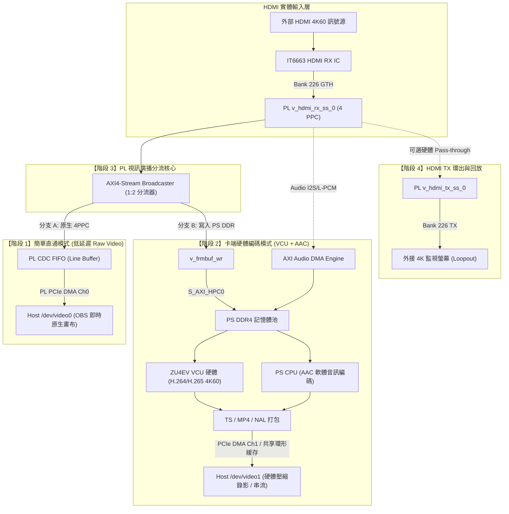

# SC7F0 ZU4EV 多階段影音採集與 VCU 硬體編碼架構規劃書
**SC7F0 ZU4EV Multi-Phase Video/Audio Ingest & VCU Hardware Encoding Plan**

---

## 📌 執行摘要 (Executive Summary)

本計畫書定義 **YUAN SC7F0 (AMD/Xilinx Zynq UltraScale+ ZU4EV)** 多通道廣播級 PCIe 影音採集與編碼卡的產品演進架構與階段性實施藍圖。
終極目標為實現兼具**「極致零延遲無損原生預覽」**與**「卡端自主硬體編碼 (H.264/HEVC + AAC) 零主機負載」**之廣播級雙流旗艦架構。

---

## 💳 硬體規格基線與晶片能力 (Hardware Baseline)

- **主控處理核心**: AMD/Xilinx Zynq UltraScale+ ZU4EV (`xczu4ev-fbvb900-2-e`)
  - **VCU 硬體視訊編解碼器**: 雙核心 H.264 (AVC) / H.265 (HEVC) 硬體核心，支援最高 4K60p 10-bit 4:2:2，具備超低延遲運動補償與階層式 GOP 控制。
  - **PS 四核心 ARM Cortex-A53 @ 1.2 GHz**: 負責控制面協定、HDMI 狀態管理、音訊 AAC 軟體編碼及 PCIe 驅動通道管理。
  - **PS DDR4 記憶體**: 64-bit 匯流排 @ 2400 MT/s，提供最高 $\approx 19.2\text{ GB/s}$（有效頻寬 $\approx 14\text{ GB/s}$）的專屬高頻寬影像緩存池。
- **HDMI RX 前端實體層**: ITE IT6663 4K60 2.0b Switch IC + NUC100 MCU 韌體控制 (I2C1)。
- **FPGA 串列收發器**:
  - GTH Bank 226: 支援 HDMI 2.0 RX (4 通道 TMDS/Clock @ 最高 5.94 Gbps) 及 HDMI TX Loopout。
  - GTH Bank 224/225: PCIe Gen2 x4 (實測 $\approx 1.6\text{ GB/s}$) / PCIe Gen3 x4 (實測 $\approx 3.2\text{ GB/s}$)。
- **PCIe 識別碼**: Vendor ID `0x12AB`, Device ID `0xE380`。

---

## 📊 系統頻寬試算與可行性分析 (Bandwidth Budget & Feasibility)

針對終極目標「階段 3：直通與編碼雙流同時運作 (1 + 2)」，進行最嚴苛之 4K60 頻寬壓力試算：

| 匯流排 / 介面 | 理論頻寬 | 有效可用頻寬 | 直通 (Mode 1) 負載 | 編碼 (Mode 2) 負載 | 同時運作 (Mode 3) 總負載 | 負載佔比安全邊界 |
| :--- | :--- | :--- | :--- | :--- | :--- | :--- |
| **PCIe Gen2 x4** | 2.0 GB/s | **1.6 GB/s** | 746 MB/s (NV12) | ~6.25 MB/s (50Mbps) | **~752.3 MB/s** | **47.0% (極為安全)** |
| **PCIe Gen3 x4** | 4.0 GB/s | **3.2 GB/s** | 746 MB/s (NV12) | ~6.25 MB/s (50Mbps) | **~752.3 MB/s** | **23.5% (極度寬裕)** |
| **PS DDR4 匯流排** | 19.2 GB/s | **~14.0 GB/s** | **0 MB/s** (純 PL) | ~3.8 GB/s (寫幀+VCU) | **~3.8 GB/s** | **27.1% (系統不卡頓)** |
| **ARM A53 CPU** | 4x 1.2GHz | 100% | 0.5% (CSR 監聽) | ~3.0% (AAC 音訊) | **~3.5%** | **> 96% 餘量可用** |

> [!TIP]
> **頻寬結論**：
> 1. 直通原生 4K60 完全不經過 PS DDR，零耗損卡端記憶體頻寬。
> 2. VCU 硬體編碼 4K60 僅消耗約 3.8 GB/s 的 DDR4 頻寬，相較於 14 GB/s 的有效上限，具有超過 70% 的餘量。
> 3. PCIe 傳輸直通 4K60 NV12 加上 50Mbps 壓縮碼流合計僅需 ~752 MB/s，在 PCIe Gen2 x4 下僅佔 47%，完全不需要降低畫質或掉幀。

---

## 🗺️ 四階段演進藍圖 (Phased Architecture Roadmap)

---

### 【階段 1】簡單直通模式 (Simple Raw Passthrough Mode)
* **定位**：低延遲原生畫質採集，專供 Host 端 OBS Studio / FFmpeg 即時畫布預覽與後製。
* **資料路徑 (Data Plane)**：
  `IT6663` $\rightarrow$ GTH Bank 226 $\rightarrow$ `v_hdmi_rx_ss_0` $\rightarrow$ CDC FIFO (96-bit 4PPC @ 150MHz $\rightarrow$ 128-bit @ 125MHz) $\rightarrow$ PL PCIe DMA Engine $\rightarrow$ Host PC 記憶體。
* **控制路徑 (Control Plane)**：
  ZU4EV PS Linux 透過 `qpcie_v4l2_bridge.ko` 綁定 `xilinx-hdmirxss.ko`，生成 `/dev/v4l-subdev0`；PS 端 `qpcie_hdmi_daemon` 監聽信號與 DV Timings 變化並寫入 PL CSR (`0x0600..0x0664`)。
* **主機端呈現**：
  Host PC 上載入 `qpcie_v4l2.ko`，生成 `/dev/video0` (支援 NV12 / YUY2 / RGB24)。
* **關鍵優勢**：
  - 延遲小於 1 幀（純硬體 Line-Buffer 直通）。
  - PS DDR 負載為 0%，PS 系統極度穩定。
* **驗收標準**：
  - [x] MCU 韌體支援動態 EDID 更新與 IT6663 初始化。
  - [x] PL HDMI RX 模組與 CDC 邏輯通過 Vivado 模擬與約束。
  - [ ] 全功能 Bitstream 燒錄至 QSPI Flash，完成冷開機驗證。
  - [ ] 接入 HDMI 訊號源，Host 端 `/dev/video0` 成功以 60fps 穩定取幀。

---

### 【階段 2】硬體編碼模式 (Hardware Compression Mode: VCU + AAC)
* **定位**：全由卡端自主完成高畫質 H.264/HEVC 視訊與 AAC 音訊壓縮，完全不佔用 Host 電腦 CPU/GPU。
* **視訊路徑 (Video Path)**：
  `v_hdmi_rx_ss_0` $\rightarrow$ `v_frmbuf_wr` $\rightarrow$ S_AXI_HPC0_FPD $\rightarrow$ PS DDR4 $\rightarrow$ **ZU4EV VCU 硬體核心** (壓製為 H.264 / H.265 NAL 單元)。
* **音訊路徑 (Audio Path)**：
  `v_hdmi_rx_ss_0` 提取 HDMI L-PCM $\rightarrow$ PL AXI Audio DMA $\rightarrow$ PS DDR4 $\rightarrow$ PS ARM A53 執行 AAC 音訊編碼 (CPU 佔用率 < 3%)。
* **傳輸與主機端呈現**：
  PS 端驅動或 GStreamer Pipeline 將壓縮後的 Elementary Stream / TS 透過專屬 PCIe DMA 通道（Ch1）送至 Host 端，Host 端註冊 `/dev/video1` (標記 `V4L2_PIX_FMT_H264` / `V4L2_PIX_FMT_HEVC`)。
* **實施重點**：
  1. 在 Vivado BD 中增加 `v_frmbuf_wr` 並連接 PS HPC AXI Slave Port。
  2. 啟用 PetaLinux VCU 驅動 (`meta-user/recipes-multimedia/vcu`) 與 Allegro VCU Firmware。
  3. 驗證 GStreamer 硬體加速管線 (`v4l2video0enc` 或 `omxh264enc`)。

---

### 【階段 3】1 + 2 同時工作 (Simultaneous Dual-Stream Mode)
* **定位**：廣播級旗艦採集卡終極型態，同時滿足「本機零延遲無損預覽」與「本機零 CPU 佔用硬體壓縮錄影/推流」。
* **核心設計**：
  在 PL 端 `v_hdmi_rx_ss_0` 的 AXI4-Stream 輸出端加入一個 **AXI4-Stream Broadcaster (1 輸入 2 輸出)**：
  - **分支 A**：直通 CDC FIFO $\rightarrow$ PCIe DMA Ch0 $\rightarrow$ Host `/dev/video0`（原生畫面）。
  - **分支 B**：進入 `v_frmbuf_wr` $\rightarrow$ PS DDR4 $\rightarrow$ VCU $\rightarrow$ PCIe DMA Ch1 $\rightarrow$ Host `/dev/video1`（H.264/HEVC 碼流）。
* **應用場景**：
  創作者在 Host 端開啟 OBS Studio：
  - 將 `/dev/video0` 放上畫布做超低延遲預覽與即時導播。
  - 同時 OBS 或背景服務將 `/dev/video1` 直接無損寫入 MP4 存檔，或透過 SRT/RTMP 推流至直播平台，Host PC 電腦效能完全不受影響！

---

### 【階段 4】HDMI TX 環出與回放 (HDMI TX Loopout & Playback)
* **定位**：支援硬體無延遲環出 (Loopout) 至現場監控螢幕，或作為 Host 端回放輸出卡。
* **實施策略**：
  在階段 1 ~ 3 之 HDMI RX 與編碼功能徹底穩定後，再啟用 Bank 226 TX 實體通道與 `v_hdmi_tx_ss_0`。

---

## 📅 推進里程碑與追蹤表 (Milestones Tracking)

| 里程碑 | 目標內容 | 關鍵交付物 | 當前狀態 |
| :--- | :--- | :--- | :---: |
| **M1.1** | IT6663 初始化與動態 EDID PCIe 燒錄通道 | `scripts/sc7f0_mcu_flash.py`, MCU FW v1.1.7 | **已完成 (100%)** |
| **M1.2** | PL 4PPC CDC FIFO、DDC 與約束驗證 | `tb/sc7f0_hdmi_bridges_tb.sv` | **已完成 (100%)** |
| **M1.3** | 全功能 HDMI Bitstream 與 XSA 匯出 | `build_zu4ev.sh`, `sc7f0_hdmi.xsa` | **執行中 (Task-24723 繞線階段)** |
| **M1.4** | PetaLinux `qpcie_v4l2_bridge` 與 Subdev 綁定 | `system-user.dtsi`, `qpcie_hdmi_daemon` | **已就緒** |
| **M1.5** | Host 端 `/dev/video0` 4K60 原生直通取幀 | `driver/qpcie_v4l2.c`, OBS Studio 實測 | **待 M1.3 燒錄後驗收** |
| **M2.1** | PL 增加 `v_frmbuf_wr` 與 PS DDR4 視訊緩存 | Vivado BD 更新, HPC 匯流排連線 | 規劃完成 (接續 M1.5) |
| **M2.2** | PetaLinux 啟用 VCU H.264/H.265 編碼驅動 | `vcu.dtsi`, GStreamer VCU Pipeline | 規劃完成 |
| **M2.3** | PCIe DMA Ch1 碼流通道與 Host `/dev/video1` | 壓縮碼流環形緩存驅動 | 規劃完成 |
| **M3.1** | AXI4-Stream Broadcaster 雙流整合測試 | 1+2 同步壓力測試與頻寬校驗 | 規劃完成 |
| **M4.1** | HDMI TX Loopout 功能評估與實作 | `v_hdmi_tx_ss_0` 整合 | 規劃完成 |
